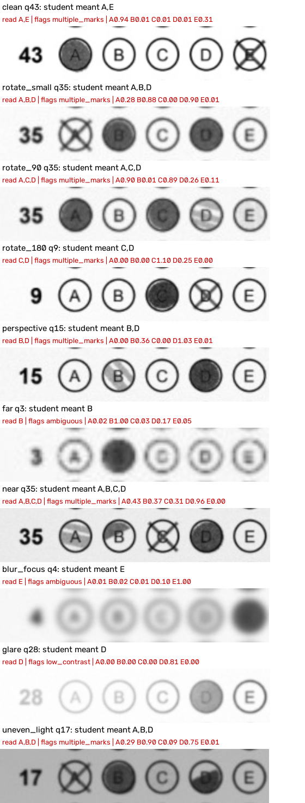

# Phase 4 accuracy report

**Approved by Yuvan on 2026-11-21:** numbers accepted; keep the cautious `multiple_marks` rule.

Measured on **600 held-out fake phone photos**: 300 per example event, generated with a seed that was never used while tuning. All 20 photo conditions are covered, 15 sheets each. Full per-condition tables:
- [A&P (54 questions)](phase-04-detector-PUSO_2026_AP_event_setup.md)
- [Forensics-shaped (11 questions)](phase-04-detector-EXAMPLE_forensics_event_setup.md)

**No real phone photos have been measured yet.** Per the plan, hands-on testing happens at the end; real photos then go through the same report (see `backend/data/real_samples/README.md`).

## Against the proposed targets

| Target (proposed in the phase plan) | A&P | Forensics-shaped | Met? |
|---|---|---|---|
| Silent errors ≤ 0.1% of questions, realistic conditions | 0.02% overall; **0** on the 14 everyday conditions | 0.09% overall; **0** on everyday conditions | Yes |
| 0 silent team-number errors | 0 | 0 | Yes |
| Question accuracy after flags ≥ 99.5%, mild conditions | 99.92% | 99.78% | Yes |
| Flag rate ≤ 3%, mild conditions | 3.02% | 1.30% | A&P at the line |
| Hard conditions: more flags allowed, same silent-error target | see below | see below | Mostly |
| < 2 s per photo | ~0.4 s (0.6 s for a 12 MP iPhone photo), one CPU core | same | Yes |

"Everyday conditions" means everything except focus blur, motion blur, glare, low light, curl and far away.

## Where it falls short, and what a grader sees

- **Low light** (dim and grainy): 4 silent errors across both events (A&P 0.37% of questions in that condition). A faint mark or erasure in heavy noise can land on the wrong side of the line. In the app, the camera screen (phase 6) should warn about dark photos before upload.
- **Glare, far away, curled paper:** 1 silent error each in 300 sheets. Otherwise these flag more (glare ~10–14% of questions, curl up to ~28% on A&P) rather than guessing.
- **Motion blur:** about 60–80% of these photos are retakes ("can't find the page"). The rest are read with many flags. A grader is asked to retake; nothing is silently wrong.
- **Focus blur:** read conservatively, with ~15–20% of questions flagged. QR reading often fails on these, so the grader confirms the event by hand.
- **Team number:** never guessed. Unclear grids (a forgotten or doubled digit, curled paper) are flagged, so team accuracy before review is ~89–91%; every miss is flagged.

## What flagged questions look like

All 10 were read correctly; each flag is caution, not an error. On good photos most flags come from one rule: a solid mark next to a much fainter tick, cross or light mark on the same question (`multiple_marks`). It exists to catch an erasure next to a real answer. Loosening it would cut A&P's review rate below 3%, but would risk letting a real erasure through as an answer.

## Decision for Yuvan
- Are these silent-error and flag rates acceptable for the tournament?
- Is the ~3% review rate on good photos OK, or should the `multiple_marks` rule be loosened to cut it (slightly more risk on erasures)? Every flagged question is a quick check on the review screen.
